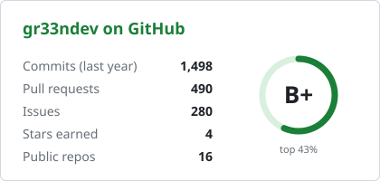

### Hi, I'm Gilian 👋

Platform Engineer at **[AEB](https://www.aeb.com)** and M.Sc. student in **AI Engineering** at FH Technikum Wien, based in Vienna.

At work I help build AEB's internal framework.
For my master's thesis I'm building a two-stage deep-learning pipeline for MRI-based brain tumor triage.
In between, I build small tools that each solve one problem well.

<picture>
  <source media="(prefers-color-scheme: dark)" srcset="assets/stats-dark.svg">
  
</picture>

#### Start here

- **[OpenAmpere](https://github.com/gr33ndev/OpenAmpere)**: open-source, cloud-free replacement for the Ampere.IQ app after EKD went insolvent. Runs locally (e.g. on a Raspberry Pi). Tested on a real FoxESS H3; *looking for SAJ H2/HS2 owners to help test.* · [demo](https://gr33ndev.github.io/OpenAmpere/)
- **[CI4TOSCA](https://elib.uni-stuttgart.de/handle/11682/17026)**: my B.Sc. thesis (University of Stuttgart) on building deployment artifacts with TOSCA.

#### Recently worked on

<!-- TOOLS:START -->
<!-- TOOLS:END -->

All 30+ tools live on **[gr33ndev.github.io](https://gr33ndev.github.io)**

<!-- CONTRIBS:START -->
<!-- CONTRIBS:END -->

#### Stack

Python · PyTorch · JavaScript · Docker · GitHub Actions · n8n · LaTeX

[LinkedIn](https://www.linkedin.com/in/gilian-rehm) · [Website](https://gilianrehm.dev)
